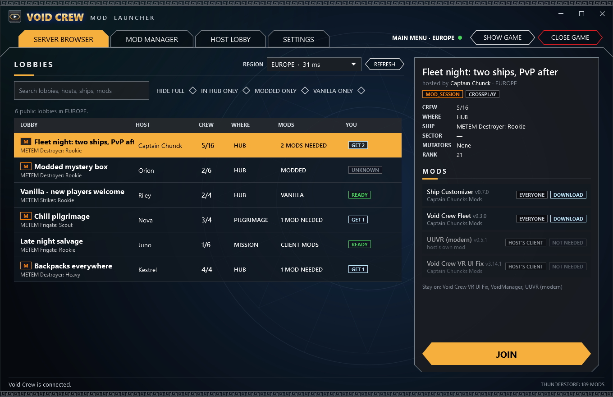
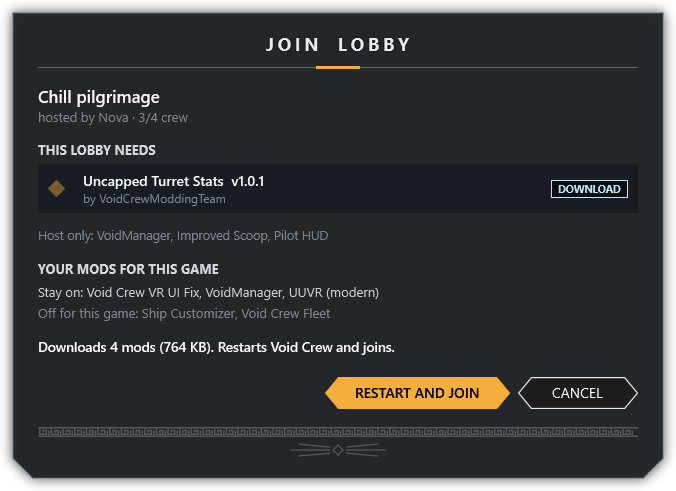
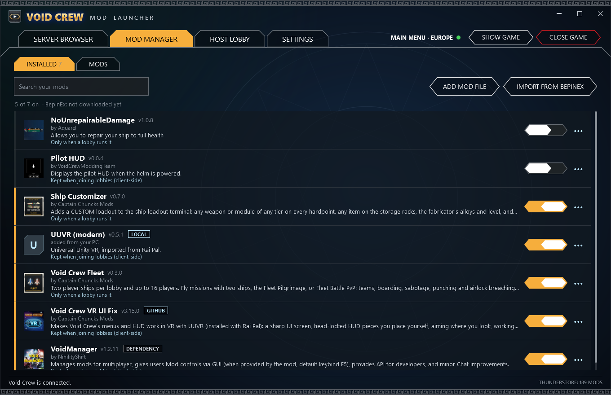
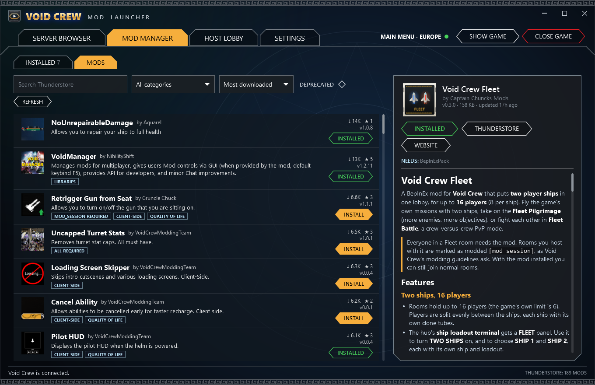
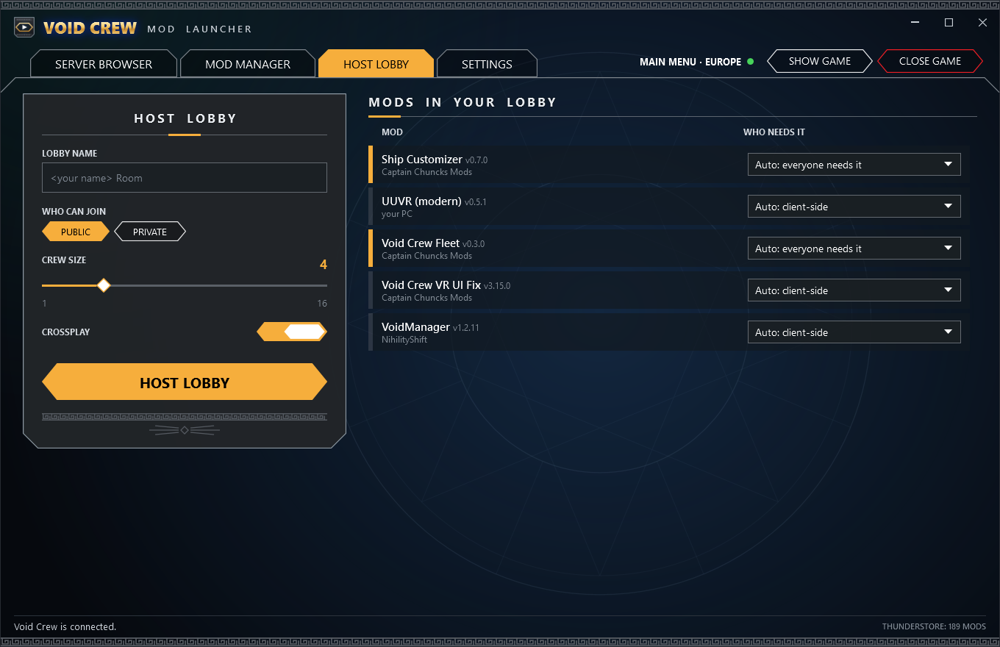
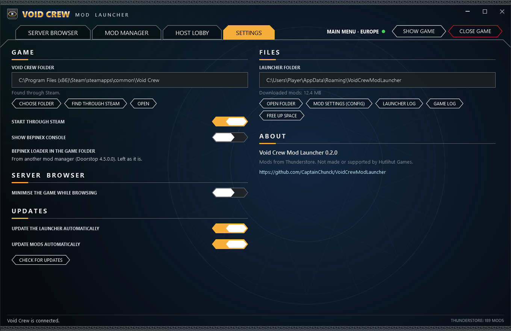
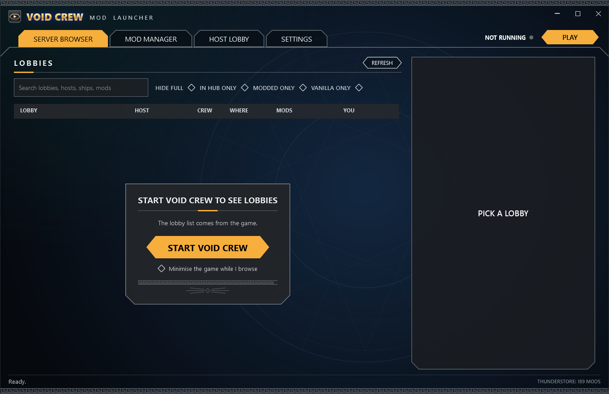

# Void Crew Mod Launcher

A launcher for **Void Crew** that makes modded multiplayer easy: see every public lobby **with the mods it runs**, and
press **JOIN**. The launcher downloads that lobby's mods from Thunderstore, starts the game with exactly those mods,
and joins the lobby for you. No more guessing which mods a lobby needs.

It is also a full mod manager (your installed mods with on/off switches, and all of Thunderstore's Void Crew mods), and
it hosts lobbies with your mods in one click.

Screenshots show sample lobbies and mods (`tools/screenshots.ps1` draws them again).

## Features

### Server browser
- Every public lobby in your region, as the game itself lists it: name, host, crew, hub or mission, ship and sector.
  Lobbies the game wouldn't let you into (another platform without crossplay, a host you've blocked) aren't listed.
- **The mods each lobby runs**, read from the lobby:
  - lobbies hosted with this launcher list their mods with exact Thunderstore ids and versions, and what joining
    players need of each;
  - lobbies whose host runs **VoidManager** (most modded lobbies) show VoidManager's list of mods and multiplayer types.
- For each mod: whether **everyone needs it** or it's only the host's, and whether you **have it**, **will download it**,
  or **can't get it** (the host's own mod, or not on Thunderstore).
- **JOIN** shows what it will do (download, which of your mods stay on, whether the game restarts), then:
  1. downloads the lobby's mods (and their dependencies, at the lobby's versions);
  2. restarts Void Crew with those mods, plus your client-side mods such as VR (only if the running game doesn't
     already have the right ones);
  3. joins the lobby as soon as the main menu is ready, switching the game to the lobby's region first if needed.
- If the game still turns you away for a mod mismatch, the launcher reads the game's list of missing and disallowed
  mods, finds them on Thunderstore and offers to fix the mods and join again.
- Filters (hide full, in hub only, modded or vanilla only), search (lobbies, hosts, ships, mods) and a region switch.

### Mod manager
- **INSTALLED**: your mods, each with an **on/off switch**. PLAY and HOST LOBBY load the mods that are on. Update
  one mod or all of them, open a mod's folder or page, or remove it.
  - Per mod, choose what happens when you join someone else's lobby: keep it on (VR, UI and other client-side mods
    stay on by default), or only load it when the lobby runs it.
  - **IMPORT FROM BEPINEX** brings in the mods you already use from another BepInEx folder (Rai Pal, r2modman or a
    manual install), installing Thunderstore's copy or copying your own build, with their settings files.
  - **ADD MOD FILE** adds a DLL or zip that isn't on Thunderstore.
- **MODS**: every Void Crew mod on Thunderstore, with search, categories, sorting, downloads and
  ratings, the mod's README, and one-click install with dependencies.
- **Updates**: at start (and on REFRESH) installed mods update to their newest versions. Each mod is checked with
  Thunderstore directly, because Thunderstore's community list can be an hour or more behind.
  - When a mod's Thunderstore page links its **GitHub repo**, the repo's latest release is checked too, and used when
    it's newer: its package zip (it must say it's that mod at that version and match GitHub's checksum), or its plugin
    DLLs put into the Thunderstore files. These versions show a GITHUB badge, and players joining your lobby get the
    same release.
  - **UUVR comes with the VR UI Fix**: installing or turning on the Void Crew VR UI Fix also installs the newest
    [UUVR](https://github.com/Raicuparta/uuvr) (its Mono "modern" build) from GitHub, unless you already have a copy
    (imported from Rai Pal, say). UUVR, as with Rai Pal, copies its VR runtime files into the game folder when it starts.
  - **While you play**, the launcher checks the game's mods every 15 minutes. When one gets an update, one quiet line
    in your own text chat says to restart Void Crew from the launcher; nothing pops up or makes a sound.

### Host lobby
- Lobby name, public or private, crew size, crossplay.
- **HOST LOBBY** starts Void Crew with your enabled mods and opens the lobby straight away (through the game's own host
  panel), landing you in your hub.
- Your lobby lists its mods for the server browser. For each mod you can say what joining players need (everyone, only
  the host, client-side), or let the launcher decide from the mod's VoidManager type or Thunderstore categories.

### Settings

Before the game is running, the server browser offers to start it (the lobby list comes from the game):

## How it works

- **The lobby list comes from your own game.** Void Crew only shows its lobbies to a signed-in game (Steam, PlayFab and
  Photon, with the game's own keys), so the launcher doesn't connect to those servers itself. Instead it starts the
  game with a small helper mod (the **bridge**) that reads the room list the game already keeps for its own join
  screens and passes it to the launcher, on your PC only (a loopback connection, guarded by a token). START VOID CREW
  on the server browser does that; the list fills as soon as the main menu is up.
- **Your game folder stays clean.** BepInEx and all mods live in the launcher's own folder (`%APPDATA%\VoidCrewModLauncher`).
  The launcher rebuilds its BepInEx folder for each launch and starts the game through Steam with BepInEx's loader
  (Doorstop) pointed at it, the way r2modman does. The game folder only needs Doorstop's two small files: if they
  aren't there yet, the launcher asks before adding them, switched off, so starting Void Crew from Steam stays
  unmodded. If another loader is already there (Rai Pal, r2modman, a manual BepInEx), it is left exactly as it is.
- **Mod settings carry over.** `BepInEx\config` is kept between launches, whichever lobby you join.
- **The bridge never changes the game.** It reads the room list, joins and hosts through the game's own join and host
  code (so the game's checks still apply), and adds the mod list to lobbies you host. It doesn't mark rooms as modded:
  your other mods do that as Void Crew's modding guidelines ask. The one setting it changes is the game's own "Can join
  [mod_session] games", which it turns on so modded lobbies can be joined.

## Install

1. Download **`VoidCrewModLauncher-Setup.exe`** from the latest
   [release](https://github.com/CaptainChunck/VoidCrewModLauncher/releases/latest).
2. Double-click it. It installs itself (Start menu and desktop shortcuts, no admin rights needed) and opens. It finds
   Void Crew through Steam (or choose its folder on the SETTINGS tab).

Windows 10 or 11 (64-bit); no .NET install needed. Windows may warn about an unrecognised app the first time: choose
**More info**, then **Run anyway**. The first launch downloads BepInEx (BepInExPack) from Thunderstore.

- **Update:** the launcher updates itself: at start it checks GitHub, downloads a new version (checked against the
  checksum GitHub lists), installs it and opens again. SETTINGS > UPDATES turns this and the mod updates off or checks
  right away. (Version 0.1.0 can't update itself: install 0.2.0 once by hand.)
- **Uninstall:** Windows **Settings > Apps > Installed apps > Void Crew Mod Launcher > Uninstall**. It asks whether to
  delete your downloaded mods and settings too, and removes BepInEx's loader from the game folder if the launcher added it.
- **Portable:** put an empty `portable.txt` next to the exe (or start it with `--portable`) and it runs where it is.

**VR players (Rai Pal):** on MOD MANAGER > INSTALLED, use IMPORT FROM BEPINEX and pick Rai Pal's BepInEx folder for Void Crew
(the launcher suggests it). UUVR and your VR mods then come along to every lobby you join.

## Files

| Where | What |
|---|---|
| `%APPDATA%\VoidCrewModLauncher\settings.json`, `library.json` | Settings and your installed mods |
| `...\store\<mod>\<version>\` | Every mod version downloaded |
| `...\runtime\BepInEx\` | The BepInEx folder the game loads (rebuilt every launch; `config\` is kept) |
| `...\runtime\BepInEx\LogOutput.log` | The game's BepInEx log (SETTINGS > GAME LOG) |
| `...\logs\launcher.log` | The launcher's log (SETTINGS > LAUNCHER LOG) |

## For websites: install links

A "download with the Mod Launcher" button is a link the launcher handles (the setup registers it for the user):

| Link | Does |
|---|---|
| `voidcrewmod://install/Namespace-Name` | Installs the newest version of a Thunderstore mod (or a newer GitHub release, see above) with its dependencies, after the player confirms |
| `voidcrewmod://install/Namespace-Name/1.2.3` | The same for one version |
| `voidcrewmod://install/github-Raicuparta-UUVR` | A GitHub-only mod the launcher knows |
| `voidcrewmod://open` | Brings the launcher up |

Ids are Thunderstore's `Namespace-Name` (`Captain_Chuncks_Mods-Void_Crew_Fleet`). Players without the launcher need
the setup first: `https://github.com/CaptainChunck/VoidCrewModLauncher/releases/latest/download/VoidCrewModLauncher-Setup.exe`.

## For mod authors

- Hosts using the launcher put a room property `VCML` in the lobby list:
  `vcml1;Namespace-Name@1.2.3!R;Namespace-Other@0.4.0!C;#LocalMod@1.0!C`, where the letter is what joining players need:
  `R` everyone, `S` session (the room must be modded, joiners don't need it), `H` host only, `C` client-side,
  `?` unknown. `#` marks a mod that isn't on Thunderstore.
- VoidManager mods are read from VoidManager's `Mods` lobby property; set `ThunderstoreID` on your `VoidPlugin` so the
  launcher can match your mod to its Thunderstore package even when its plugin name differs.
- Thunderstore categories decide what joiners need for mods the launcher knows nothing else about: `All Required` means
  everyone needs it, `Client-Side` only the player's own game, `Host-Side` only the host.

## Building from source

- **Requirements:** the .NET 10 SDK, and Void Crew with BepInEx 5 installed (the bridge plugin builds against the game).
- **Build and test:** `powershell -ExecutionPolicy Bypass -File tools\build-and-test.ps1 -VoidCrewDir "<game folder>" -BepInExDir "<BepInEx folder>"`
  builds everything, runs the offline tests and checks that every game method the bridge uses is still in the game.
- **Release:** `powershell -ExecutionPolicy Bypass -File tools\package.ps1` makes `dist\VoidCrewModLauncher-Setup.exe` (the
  one-click install).
- **Screenshots:** `powershell -ExecutionPolicy Bypass -File tools\screenshots.ps1` redraws `docs\screenshots`.
- **Look at the pages without the game:** `VoidCrewModLauncher.exe --render-previews <folder>` draws every page with
  sample lobbies into PNGs.
- `--data-dir <folder>` (or the `VCML_DATA_DIR` environment variable) runs the launcher with a separate data folder.
- To try the install or the self-update without touching your real install: `VCML_INSTALL_ROOT=<folder>` installs into
  that folder (and a test registry key), and `VCML_UPDATE_FEED=<url>` reads the release from that URL (GitHub's release
  JSON) instead of GitHub.

## License

GPL-3.0. See [LICENSE](LICENSE). Not made or supported by Hutlihut Games.
